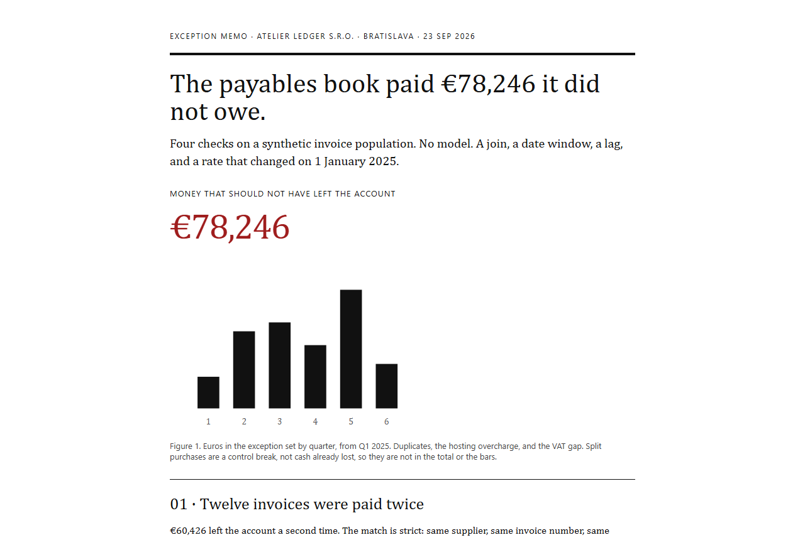

# Payables exception memo

[](https://github.com/LiKeT128/invoice-audit/actions/workflows/build.yml) · **[Live memo →](https://liket128.github.io/invoice-audit/)**

A one-page memo. The question is how much of a fictional Bratislava payables book should not have been paid, and which failure is a control break rather than lost cash.

The memo is filled from SQL. `build_report.py` runs the queries and writes the sentences. The headline number is not typed in by hand.

On the seeded book the cash that should not have left is **€78,246**:

| Check | Result | In the €78,246? |
| --- | --- | --- |
| Duplicate payments | 12 invoices, €60,426 paid again | Yes |
| Price above contract | Danube Hosting, €13,500 | Yes |
| VAT booked at 20% instead of 23% | 18 invoices, €4,320 | Yes |
| Pairs under a €5,000 signature | 8 pairs, €2,950 over the line together | No |

The last row is excluded on purpose. The supplier was still owed the money. The failure is that two invoices a few days apart each stayed under the single-signature limit.



## Run

```powershell
python build_report.py
```

Open `report/index.html`. Python 3.11+ and the standard library. No packages.

## The queries

1. `sql/01_duplicates.sql` — self-join on supplier, invoice number, and gross. The later row is the duplicate.
2. `sql/02_split_purchases.sql` — two different invoice numbers, same supplier, at most six days apart, each under the limit, each material, together over the limit.
3. `sql/03_price_drift.sql` — monthly seat price against a contract stuck at €42, plus `LAG` against the previous month.
4. `sql/04_vat_rate.sql` — booked rate against the vendor master. Rates are basis points, so 23% is 2300 and the gap stays in integers.

The VAT fact is real. The standard Slovak rate has been 23% since 1 January 2025. The old standard rate was 20%. The invoices are not real.

## What this does not do

It does not look for fraud with a model, and it does not net off credit notes. The book has none. A credit with the same invoice number and the opposite gross would need its own test before it was allowed to reduce the €60,426.
